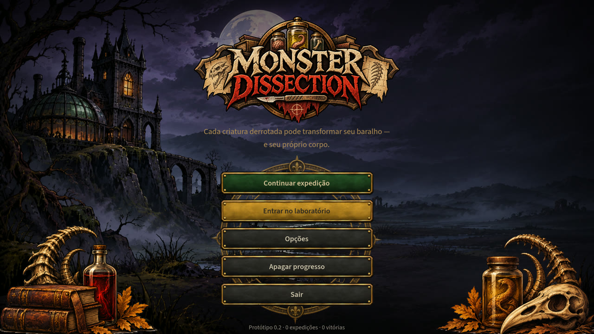
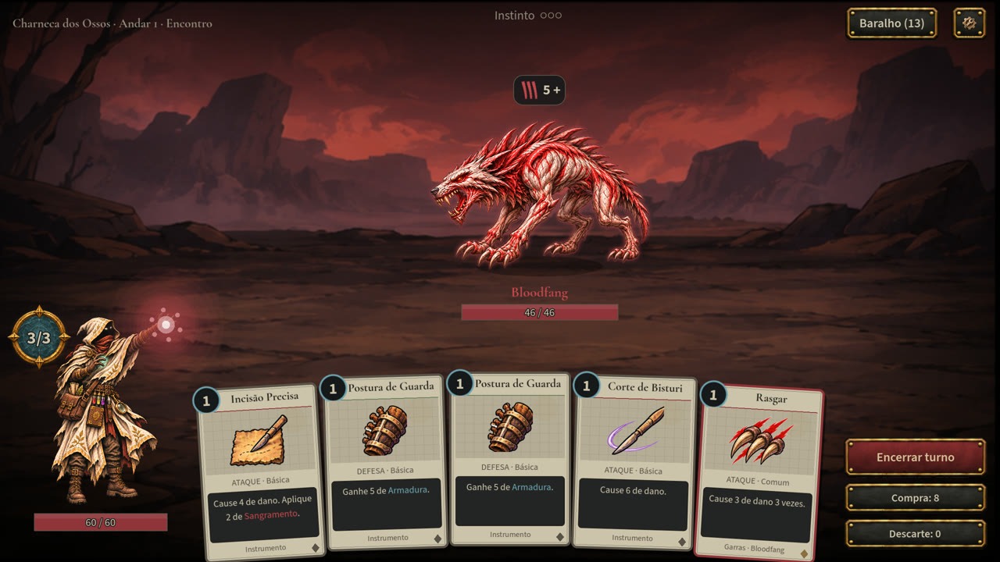
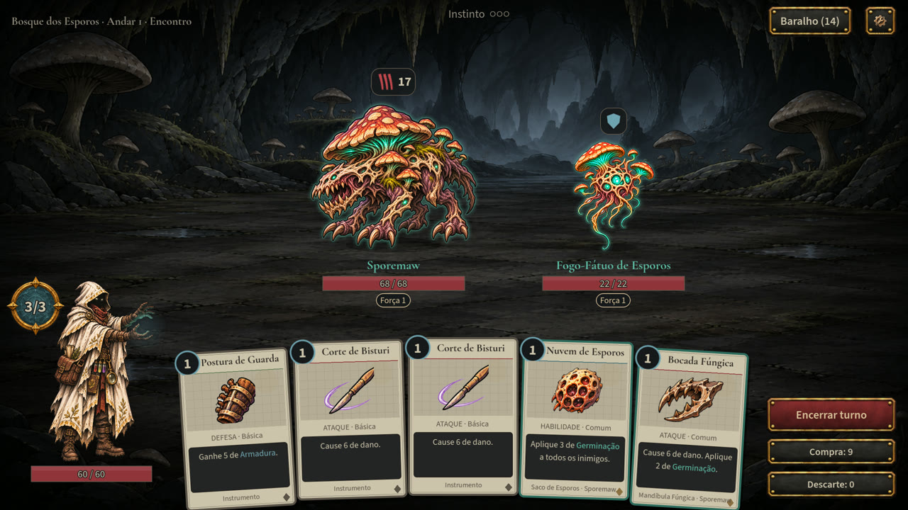
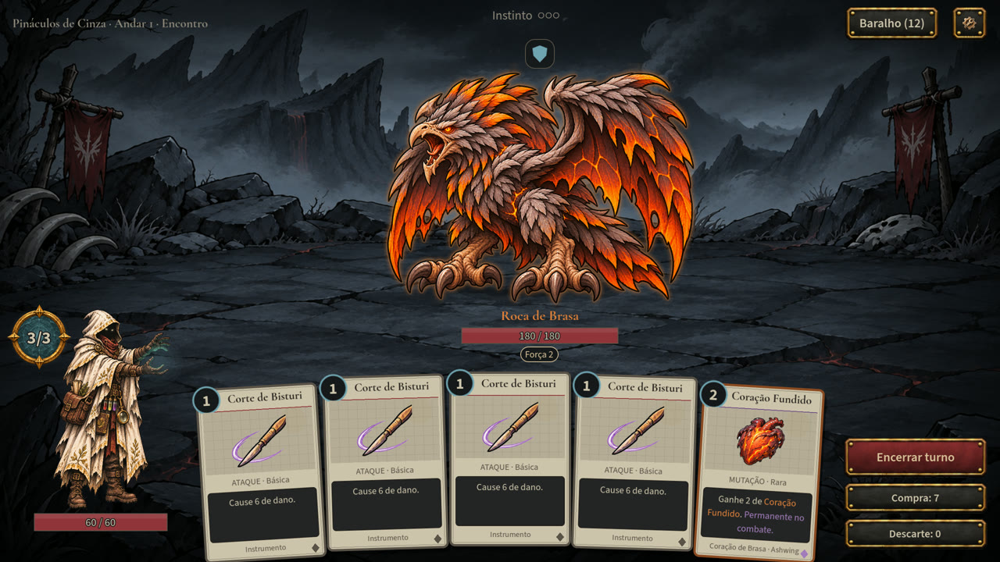
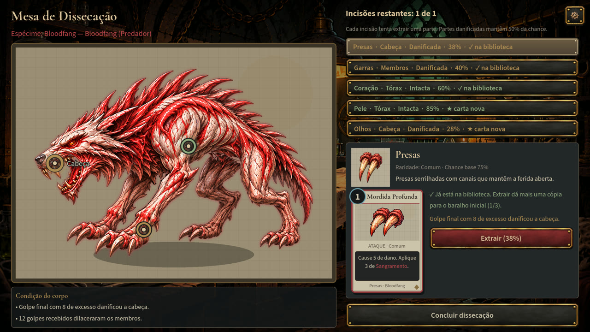
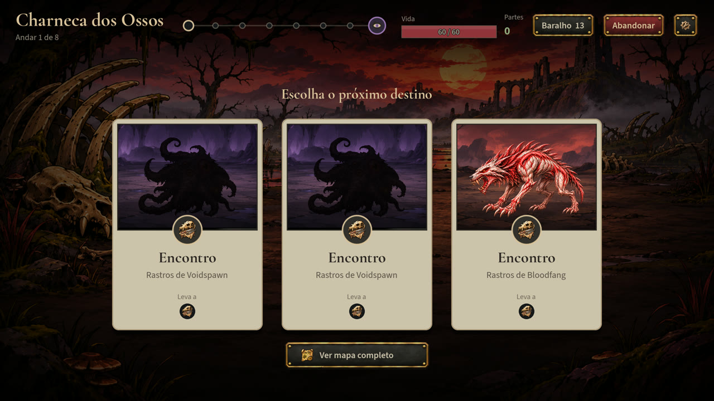
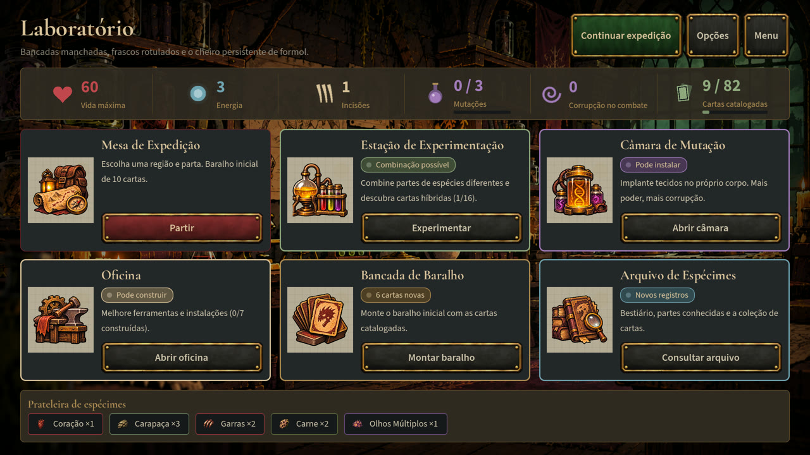
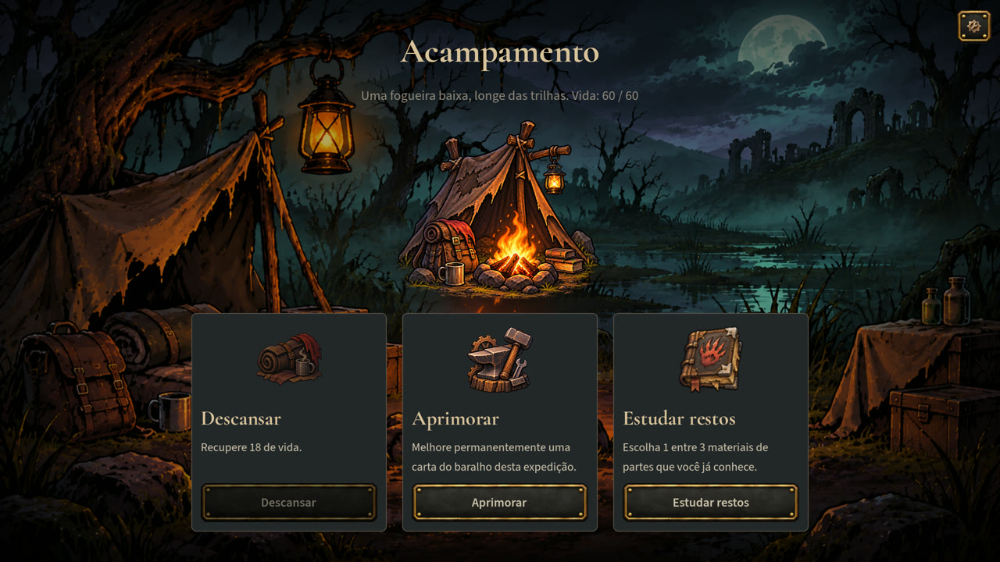

# Monster Dissection

Roguelite de cartas em um mundo de fantasia sombria. Você é um naturalista arcano: enfrenta criaturas, leva os
corpos para a mesa de dissecação e transforma o que conseguir extrair em novas cartas, cartas híbridas e mutações.

> **Versão de teste.** O balanceamento ainda está em ajuste e podem aparecer bugs.

<table>
  <tr>
    <td width="50%"></td>
    <td width="50%"></td>
  </tr>
  <tr>
    <td></td>
    <td></td>
  </tr>
  <tr>
    <td></td>
    <td></td>
  </tr>
  <tr>
    <td></td>
    <td></td>
  </tr>
</table>

## Download

Baixe a versão mais recente na página de **[Releases](https://github.com/steniols/monster-dissection/releases/latest)**,
na seção *Assets*:

| Plataforma | Arquivo |
|---|---|
| Android (64 bits, Android 7 ou superior) | o arquivo `.apk` |
| Windows 10/11 (64 bits) | o arquivo `.exe` |

## Instalação

### Android

1. Abra a página de Releases **no celular ou tablet** e toque no arquivo `.apk` para baixar.
2. Abra o arquivo baixado (pela notificação ou pelo app *Arquivos*).
3. Se o Android avisar que a instalação de apps desconhecidos está bloqueada, toque em **Configurações** e ative
   **Permitir desta fonte** para o navegador ou gerenciador de arquivos que você usou. Depois volte e toque em **Instalar**.
4. Se o Play Protect mostrar um alerta de app desconhecido, toque em **Mais detalhes → Instalar mesmo assim**.

O jogo roda na horizontal. Para atualizar, instale o APK novo por cima do antigo: o progresso é mantido.

### Windows

1. Baixe o arquivo `.exe` e coloque-o em qualquer pasta. Não precisa instalar.
2. Dê dois cliques para abrir.
3. Se o Windows SmartScreen avisar que o app não é reconhecido, clique em **Mais informações → Executar assim mesmo**.

Para atualizar, substitua o `.exe` antigo pelo novo.

## Controles

- **Android:** toque para jogar uma carta e, se ela precisar de alvo, toque no monstro. Arraste para rolar listas.
  Toque em cartas, status e intenções para ver a explicação.
- **Windows:** mouse, como no Android. **F11** ou **Alt+Enter** alterna entre tela cheia e janela.
- A engrenagem no canto abre a pausa e as opções (volumes, tela cheia e efeitos de impacto).

## Progresso salvo

O progresso fica salvo no próprio aparelho e a expedição atual é retomada em **Continuar**.

- **Windows:** `%APPDATA%\Godot\app_userdata\Monster Dissection`
- **Android:** nos dados do app. Desinstalar o jogo apaga o progresso.

## Como se joga

- **Combate:** cada turno você tem energia para jogar cartas. Os monstros mostram a intenção da próxima ação.
  Três cartas seguidas da mesma família ativam o **Instinto**.
- **Dissecação:** depois de vencer, use suas incisões para extrair partes. A forma como o monstro morreu define o
  estado do corpo e a chance de cada extração. Cada parte pode virar uma carta permanente na sua biblioteca.
- **Expedição:** escolha o caminho pelo mapa entre combates, covis, eventos, acampamentos e o chefe da região.
  Se você sucumbir, parte do material coletado se perde.
- **Laboratório:** entre expedições, monte o baralho inicial, combine partes em cartas híbridas, instale mutações
  (cuidado com a Corrupção), construa melhorias na oficina e consulte o arquivo de espécimes.
- **NG+:** depois de concluir as 4 regiões, cada uma pode ser refeita em dificuldades maiores.

## Problemas e sugestões

Abra uma [Issue](https://github.com/steniols/monster-dissection/issues) descrevendo o que aconteceu, em qual
aparelho e, se possível, com um print.

## Desenvolvimento

Para abrir o projeto no Godot, rodar os testes ou adicionar conteúdo, veja [docs/DESENVOLVIMENTO.md](docs/DESENVOLVIMENTO.md).
